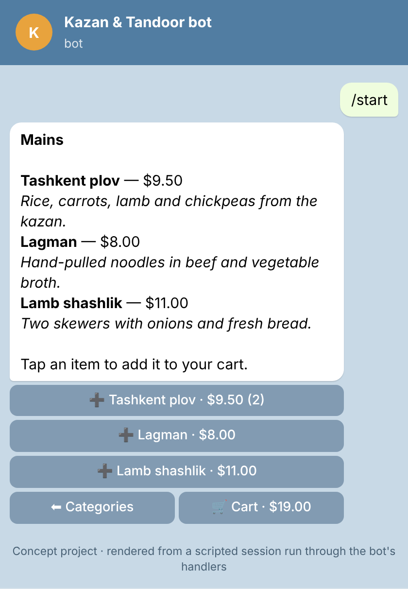
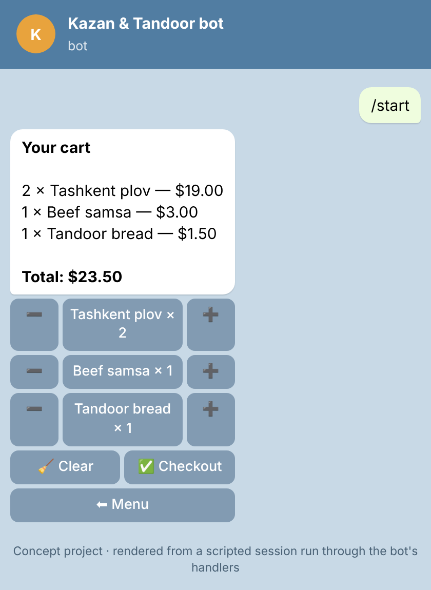
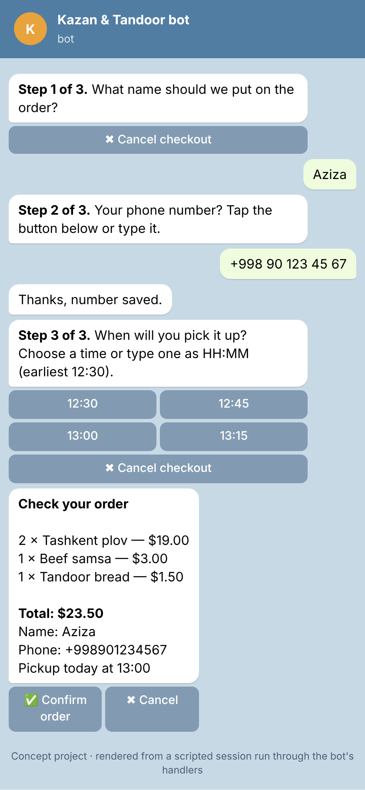
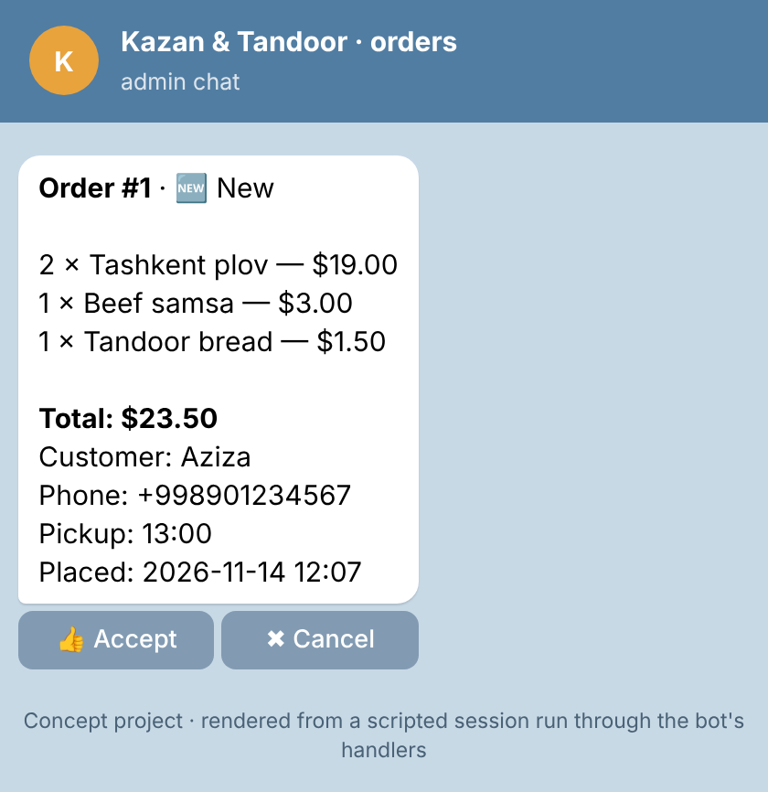

# Cafe Order Bot (Telegram, Python)

> **Concept project.** Kazan & Tandoor is a fictional cafe used to demonstrate the bot. Not deployed for a real business.

A Telegram bot that takes pickup orders for a cafe: the customer browses the menu by category, builds a cart, leaves a name, phone number and pickup time, and the cafe gets the order in an admin chat with buttons to accept it or mark it ready. The customer is notified at each step.

| Menu | Cart | Checkout | Admin chat |
| --- | --- | --- | --- |
|  |  |  |  |

The screenshots are rendered by [`tools/render_demo.py`](tools/render_demo.py), which runs a scripted session through the bot's real handlers and draws the resulting messages and buttons. They are not captured from the Telegram app.

## Features

- Menu by category from a plain `menu.json` file — edit prices and items without touching code
- Cart with ➕ / ➖ per item, clear, and a running total on the cart button
- Three-step checkout: name → phone (typed or shared with one tap) → pickup time
- Pickup slots respect opening hours and preparation time; typed times are validated
- Order summary and confirmation before anything is sent
- New orders go to an admin chat with **Accept → Ready for pickup / Cancel** buttons; the customer gets a message on each status change
- Orders are stored in SQLite (`orders.sqlite3`)
- No third-party packages: runs on the standard library and the Telegram Bot API (long polling)
- 43 automated tests covering the full order flow, validation and the HTTP client

## Quick start

Requires Python 3.10+.

1. Create a bot with [@BotFather](https://t.me/BotFather) and copy its token.
2. Find the chat id that should receive orders: send any message to your bot, then open `https://api.telegram.org/bot<TOKEN>/getUpdates` and copy `message.chat.id`. For a group, add the bot to the group first; group ids start with `-`.
3. Configure and run:

```bash
git clone https://github.com/vvlrt-dev/cafe-order-bot.git
cd cafe-order-bot
cp .env.example .env        # then fill in BOT_TOKEN and ADMIN_CHAT_ID
python -m bot.main
```

Send `/start` to your bot.

## Configuration

All settings live in `.env` (or real environment variables):

| Variable | Default | Meaning |
| --- | --- | --- |
| `BOT_TOKEN` | — | Token from @BotFather (required) |
| `ADMIN_CHAT_ID` | — | Chat that receives orders (required) |
| `TIMEZONE` | `Asia/Tashkent` | Cafe time zone, used for pickup times |
| `OPENS_AT` / `CLOSES_AT` | `10:00` / `22:00` | Pickup window |
| `PREP_MINUTES` | `20` | Minimum time between ordering and pickup |
| `MENU_PATH` | `menu.json` | Menu file |
| `DB_PATH` | `orders.sqlite3` | SQLite database for orders |

## Project structure

```
bot/
  main.py          long-polling loop
  handlers.py      conversation logic (menu, cart, checkout, admin actions)
  keyboards.py     inline and reply keyboards
  texts.py         message texts (user input is HTML-escaped)
  validation.py    name, phone and pickup-time rules
  cart.py          cart model
  menu.py          menu loader
  storage.py       SQLite order storage
  telegram_api.py  minimal Bot API client (urllib)
  config.py        settings from .env
tests/             pytest suite with a fake Telegram client
tools/             demo screenshot renderer
menu.json          example menu
```

`OrderBot` talks to Telegram only through `send_message`, `edit_message` and `answer_callback`, so the whole conversation is tested with a recording fake instead of the network.

## Tests

```bash
pip install -r requirements-dev.txt
python -m pytest
```

## Notes and limits

- Carts and checkout progress are kept in memory and reset when the bot restarts. Placed orders are saved in SQLite.
- Payment is taken at pickup. Online payment (Telegram Payments, Click, Payme, Stripe) would be a separate step.
- Long polling suits a single cafe. For higher traffic, switch to a webhook behind HTTPS.

## License

MIT
